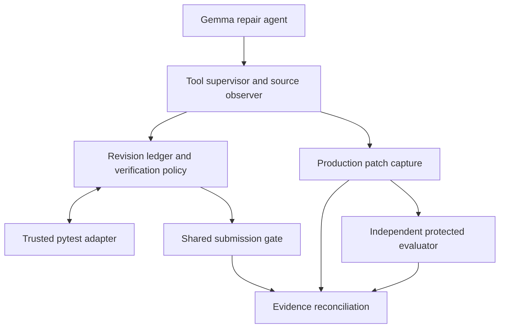

# Revision-Aware Repair Verification for Gemma 4 Software Repair Agents

Research companion for the **Gemma 4 Developer Agent Paper Track** by **Clifford Imaguezegie**.

## Start here — public Kaggle companion

**Primary reviewer entry point:** [**Public Kaggle RARV companion notebook**](https://www.kaggle.com/code/cliffordimaguezegie/gemma4-revision-aware-repair-verification/notebook). It presents the architecture, study evidence, runnable E17 CPU replay, archived-result reconciliation and source-module inspection without running Gemma inference. Attach the [public E17 evidence dataset](https://www.kaggle.com/datasets/cliffordimaguezegie/gemma4-rarv-evidence) when running on Kaggle.

- [**Saved Kaggle notebook export**](notebooks/Gemma4_RARV_Kaggle_Companion_v2_6.ipynb)
- **Reproduction instructions:** [CPU verification, optional full archive audit and original GPU experiment paths](evidence/REPRODUCE.md).

## Objective

A test pass describes the code revision on which the test ran. After an autonomous software-repair agent edits production code, that earlier pass may no longer be valid evidence for the current revision. **Revision-Aware Repair Verification (RARV)** examines whether proactively refreshing such evidence helps a Gemma 4 repair agent, compared with requiring current evidence only when it submits its patch.

The study keeps three questions separate:

1. **Evidence freshness:** Does a trusted test result still apply to the currently observed source revision?
2. **Test-oracle adequacy:** Does the selected check exercise the behaviour the task actually requires?
3. **Verified delivery:** Did the *same* production patch that passed independent grading reach an accepted submission?

## Research contributions

The contribution is an **implemented verification framework**, a **matched empirical study**, and **trace-based evidence about assurance boundaries**. The novelty lies in making established techniques work together as an auditable agent-repair process and evaluating what that process can establish—not in inventing revision tracking, state machines or automated testing.

### C1 — An integrated, auditable verification framework

RARV wraps a non-deterministic Gemma 4 coding agent with deterministic evidence and submission controls, while retaining the agent's autonomous tool selection:

- **Revision tracking:** a tool-boundary observer fingerprints eligible production files and records monotonically advancing source revisions.
- **Trusted receipts:** an isolated pytest adapter binds qualified results to the source revision and digest, registered check and environment identities, and execution provenance.
- **Evidence-aware policies:** a ledger distinguishes current, stale, failing and unverified results. **Policy B** requires current evidence at submission; **Policy C** uses the same gate and also rechecks a previously passing registered test after a qualifying edit, within budget.
- **End-to-end provenance:** production-only patch capture, a shared final gate, independent protected grading and reconciliation associate the receipt, edit, policy decision, exact candidate patch, grade and delivery outcome.

**Evidence:** the frozen production controller, trusted adapter and gate execute in the [CPU review package](evidence/Gemma4_RARV_CPU_Review_Package_v1_0.zip). The recorded implementation and attempt artifacts cover FastAPI, Rich and Requests in the evaluated Python harness. Portability to other languages or harnesses is an architectural possibility, not an experimentally established result. [Architecture and evidence index](docs/evidence-index.md) · [Reproduction guide](evidence/REPRODUCE.md)

### C2 — A matched study that measures whether proactive verification actually activates

Instead of assuming that extra checks are useful, we separate the **opportunity to recheck**, **the controller's detection behaviour** and **the resulting patch outcome**:

- **Primary autonomous comparison (GP03):** nine matched task pairs use the same Gemma 4 model, prompts, tools, registered checks, final submission gate and budgets. **B and C each achieved 6/9 protected passes**, a C-minus-B difference of **0.0 percentage points** (95% repository-stratified bootstrap interval **−22.2 to +22.2 points**).
- **Natural exposure measurement:** across **24 autonomous runs** in GP03–GP05, **zero** trusted passing receipts were followed by a qualifying observed production edit. Thus the effect of proactive rechecking *after a naturally occurring trigger* remains unestimated.
- **Controlled activation (GP04):** two deliberately invalidating edits caused C to detect test failures in **1.150 s** and **1.047 s**, before the first model request. This demonstrates that the mechanism responds when triggered; it **does not** demonstrate improved autonomous repair success.

**Evidence:** frozen comparisons, recorded controller events, independently graded patches and [reconstructed results](evidence/validation/Results_Bundled.json). The primary estimate is limited by nine pairs, one rollout per arm and the chosen public checks.

### C3 — Concrete findings about where verification evidence stops being sufficient

The case traces show that **freshness, test relevance, independent patch grading and successful delivery are different assurance claims**:

- **A fresh check may be the wrong oracle:** on `fastapi_14258`, both patches passed the public gate but failed protected grading. On `requests_7309`, a public selector blocked two patches that passed the protected suite.
- **A protected pass is not universal correctness:** the controlled `requests_7205` captures retained the deliberately injected proxy fault, even though both passed the executed protected grading suite. The registered public check did expose that fault.
- **A passing patch is not necessarily delivered:** three GP03 protected-passing captures never reached verified submission. The study therefore tracks gate acceptance and the independent protected result against the **same patch identity**, separately from patch quality.

**Evidence:** joined source checkpoints, test receipts, captured diffs, protected grades and submission dispositions. These cases identify assurance gaps; they do not establish how common such gaps are outside the measured tasks.

### Reproducibility deliverable supporting C1–C3

The [E17 CPU review package](evidence/Gemma4_RARV_CPU_Review_Package_v1_0.zip) runs the **actual frozen controller**, trusted pytest adapter and submission gate on a synthetic Git fixture. It executes six trusted checks with **zero model calls** and verifies B/C state transitions. Its checker also validates selected original archive members and reconstructs the recorded primary and follow-up results. With the seven original sealed archives, full mode can audit **all 28 captured candidate records**. These checks do **not** reproduce fresh autonomous Gemma runs or rerun the organiser's withheld protected tests.

## Architecture

The tool supervisor observes Gemma's actions and changes to tracked production files. A trusted test receipt binds a result to the checked revision, content, registered test definition and environment. The ledger and verification policy use those identities at tool boundaries and at submission.

| Policy | After a qualifying edit invalidates a trusted pass | At submission |
|---|---|---|
| **B · Final gate** | Marks the receipt stale and awaits the next check or submission. | Reuses current evidence or reruns missing/stale checks within budget. |
| **C · Proactive recheck** | Marks the receipt stale, reruns the registered check within budget and returns the current result to the agent. | Uses the **same** gate and acceptance criteria as B. |

The runner captures eligible production diffs, including candidates present at the deadline. Independent evaluation applies each candidate to a clean snapshot. **Verified delivery** requires accepted submission and a protected pass on that same patch, joined through attempt and candidate identities.

## Evaluation and findings

| Cohort | Matched task pairs | Agent runs | Protected passes per policy |
|---|---:|---:|---:|
| GP03 primary autonomous | 9 | 18 | 6/9 |
| GP04 and GP05 autonomous follow-up | 3 | 6 | 1/3 |
| GP04 controlled activation | 2 | 4 | 2/2; see detection and recovery limitations below |

- **Primary protected repair:** all nine GP03 pairs received final independent scores; B and C each passed **6/9**. The paired difference was **0.0 percentage points** (95% bootstrap interval **−22.2 to +22.2**).
- **Verified delivery:** **5/9 for B**, **4/9 for C** in GP03. Three passing captured candidates were not delivered.
- **Natural activation:** **0 qualifying pass-to-edit exposures** across 24 autonomous runs, so the causal effect of proactive rechecking on naturally triggered repairs remains unknown.
- **Controlled activation:** C detected the two deliberately introduced failures in **1.150 s** and **1.047 s** before the first model request. Both Rich captures restored the known-good seed; both Requests captures retained the injected fault even though they passed the executed protected suite. **No controlled attempt achieved verified delivery.**

The comparison uses one rollout per policy per task across three Python repositories. All nine primary registered public checks passed on their buggy baselines; these were executable checks, but the passes did not demonstrate that they discriminated the reported issues. [Evidence index](docs/evidence-index.md) · [Reconstructed results](evidence/validation/Results_Bundled.json)

## Reproduction routes — choose the appropriate level of evidence

| Route | Entry point | What it establishes | Requirements |
|---|---|---|---|
| **A — CPU reviewer verification (recommended)** | [Public Kaggle companion](https://www.kaggle.com/code/cliffordimaguezegie/gemma4-revision-aware-repair-verification/notebook) or [E17 package](evidence/Gemma4_RARV_CPU_Review_Package_v1_0.zip) | Executes the frozen controller on a synthetic Git fixture and reconstructs recorded results from bundled evidence | No Gemma GPU or new model calls. Local documented setup: Linux, Python 3.12, Git and offline wheels; the hosted companion documents its own Kaggle runtime |
| **B — Original GPU study procedures** | [GP00–GP05 notebooks](docs/evidence-index.md) and [stage inputs below](#implementation-prerequisites--original-google-competition-inputs) | Re-executes relevant study methods where inputs and permissions are available; a fresh agent rollout is not guaranteed to reproduce historical traces | Compatible GPU, pinned Gemma model and runtime, task repositories, datasets, stage-specific fixtures; protected grading additionally needs authorised evaluator assets |
| **Optional — Full sealed-archive candidate audit** | E17 `reconcile_results.py --archives ...` | Verifies original archive digests and reconciles all 28 recorded captured candidate records | Seven sealed original archives; not publicly bundled |

**Route A detail:** The frozen E17 fixture performs six trusted pytest checks with **zero model calls**. After a scripted production edit, B holds a stale receipt and C records a current failure; both gates block the broken state and accept the restored state. [Replay validation](evidence/validation/Replay_Report.json). Its results checker matches selected archived evidence to independent protected grades using exact attempt and candidate identities. [Bundled results](evidence/validation/Results_Bundled.json).

**Boundaries:** CPU replay does **not** perform a new autonomous repair, rerun withheld protected tests or establish superior Policy C success rates. Original-archive reconciliation verifies historical records; it is not a fresh protected evaluation. [Detailed procedures](evidence/REPRODUCE.md) · [Archive provenance](evidence/Archive_Provenance.json).

## Study materials

The [evidence index](docs/evidence-index.md) traces the research from task audit and development through GP03, GP04 and GP05. Released notebooks preserve study source and refer to the organiser's public input mounts. Original raw traces, protected tests, competition assets and full candidate archives are **not** part of the public repository; some verification steps require authorised access to those records.

[Study notebooks and evidence](docs/evidence-index.md) · [References](docs/references.md) · [Kaggle Paper Track](https://www.kaggle.com/competitions/gemma-4-developer-agent-paper/overview)

## Implementation prerequisites — original Google competition inputs

**The implementation notebooks are not standalone CPU demos.** For GP00–GP05, first attach the original **Google — The Gemma 4 Developer Agent Competition** datasets and inputs in Kaggle. The following are the mounted locations supplied for this project:

| Input | Kaggle mount path | Intended use |
|---|---|---|
| Competition dataset | `/kaggle/input/competitions/gemma-4-developer-agent` | Published tasks, repository snapshots and organiser evaluator inputs |
| Datafix | `/kaggle/input/datasets/cliffordimaguezegie/datafix` | Supplementary evaluation/data fixes |
| Requests fixture wheels | `/kaggle/input/datasets/cliffordimaguezegie/gp03-requests-fixture-wheels-v1` | Requests' offline HTTP/HTTPS grading fixtures |
| GP03 test wheels | `/kaggle/input/datasets/cliffordimaguezegie/gp03-test-wheels-v2` | Pinned grading/test dependencies |
| Organiser wheelhouse | `/kaggle/input/datasets/metric/gemma-4-developer-agent-wheelhouse` | Offline organiser runtime dependencies |
| Gemma 4 31B QAT checkpoint (v2) | `/kaggle/input/models/google/gemma-4/other/gemma-4-31b-it-qat-w4a16-ct/2` | Live Gemma 4 GPU evaluation; use the project's pinned model and adapters |
| **E17 CPU evidence ZIP** | `/kaggle/input/datasets/cliffordimaguezegie/gemma4-rarv-evidence` | **The companion's CPU replay and archived-result reconstruction** |

**Execution requirements by stage:** GP00/GP01 and the GP02C/GP03 CPU qualification stages require the dataset, repository snapshots and their compatible offline dependencies. Live GP02B, GP02C worker, GP03, GP04 and GP05 model experiments require a compatible **GPU environment** (the reported runs used four NVIDIA L4s), the pinned model/runtime, and the stage's original source/evidence inputs. Independent protected grading requires the organiser's authorised evaluator assets and, for historical archived-grade reconstruction, the corresponding sealed archives. The supplementary datasets above address known fixture/dependency recovery; **which of them is needed varies by notebook**.

**Reproduction meaning:** The implementation notebooks contain code and methods and may reproduce their *procedures* when all original inputs and hardware are available. A fresh non-deterministic Gemma run need not produce byte-identical historical tool trajectories. Saved outputs correspond to the recorded source sessions and must not be presented as new runs.

