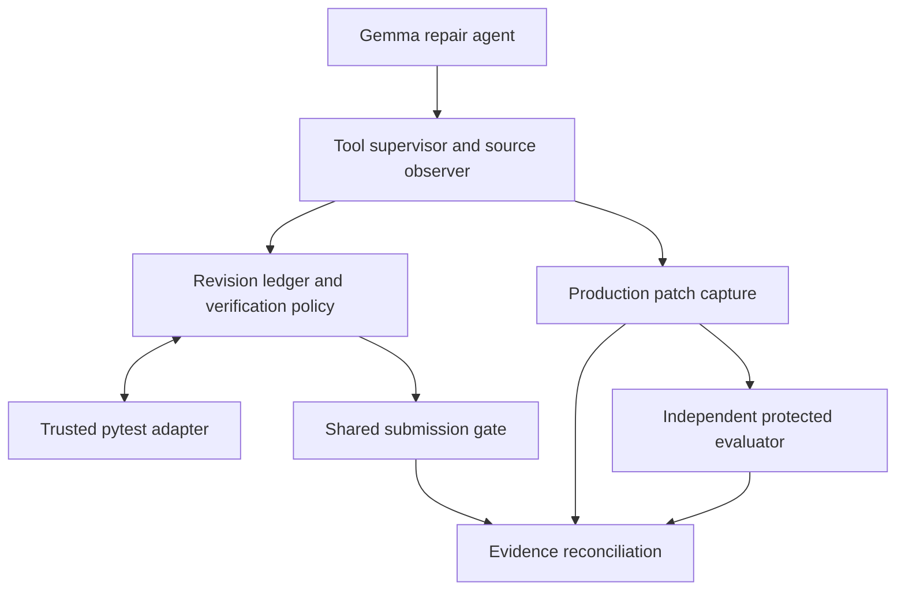

# Revision-Aware Repair Verification for Gemma 4 Software Repair Agents

Research companion for the Gemma 4 Developer Agent Paper Track by Clifford Imaguezegie.

## Objective

A test pass describes the code revision that was tested. When a repair agent edits production code, the earlier pass may no longer apply. This study asks whether a Gemma 4 agent benefits from receiving a fresh test result immediately after such an edit. Both evaluated policies require current test evidence at submission. One policy also rechecks while the agent is still working.

The framework tracks three questions separately. Does the result still apply to the current revision? Does the check exercise the relevant behaviour? Did the independently graded patch reach accepted submission?

## Architecture

The controller observes tool actions and fingerprints the tracked production files. The trusted pytest adapter executes a registered check in isolation and issues a **test receipt** containing the outcome, source revision and digest, check identity and environment identity. The ledger uses these fields to decide whether the receipt is current.

| Policy | When a production edit invalidates a trusted pass | At submission |
|---|---|---|
| **B · Final gate** | Marks the receipt stale. | Reuses a current pass or reruns a stale or missing check within the remaining budget. |
| **C · Proactive recheck** | Marks the receipt stale, reruns the check within budget and returns the current result to the agent. | Uses the same gate as B. |

The runner captures the production diff, including candidates present at the deadline. The protected evaluator applies that diff to a clean snapshot and grades it independently. **Verified delivery** requires both gate acceptance and a protected pass for the same patch. The attempt, revision and patch digest connect these records.

## Evaluation and findings

| Cohort | Matched task pairs | Agent runs | Protected passes per policy |
|---|---:|---:|---:|
| GP03 primary autonomous | 9 | 18 | 6/9 |
| GP04 and GP05 autonomous follow-up | 3 | 6 | 1/3 |
| GP04 controlled activation | 2 | 4 | See detection findings below |

- **Primary repair outcome.** All nine GP03 pairs resolved. The paired difference was **0.0 percentage points** with a 95% repository-stratified bootstrap interval of **−22.2 to +22.2 points**. Verified delivery was **5/9 for B and 4/9 for C**. Three protected-passing candidates came from deadline captures without verified delivery.
- **Autonomous activation.** Across **24 autonomous runs**, no trusted pass was followed by a qualifying production edit. The effect of proactive rechecking after a naturally occurring trigger remains open.
- **Controlled activation.** C detected the two deliberately introduced failures in **1.150 s and 1.047 s** before the first model request. Both captures in one controlled task retained the injected fault and passed protected grading, exposing a coverage gap in the tests used for that task.

The primary comparison uses one rollout per policy per task across three Python repositories. All nine registered public checks passed on the original buggy snapshots. Those baseline passes established that the checks could run and limited what they could tell us about the reported defects. [Evidence index](docs/evidence-index.md) · [Reconstructed results](evidence/validation/Results_Bundled.json)

## Contributions

1. **Revision-bound verification.** An implemented controller that connects trusted test receipts, source revisions and the exact production patch accepted or captured.
2. **A matched comparison of recheck timing.** The same submission gate and matched budgets isolate the proactive recheck policy. Controlled runs show how the controller responds when the trigger occurs.
3. **Evidence about verification boundaries.** The trace analysis distinguishes receipt freshness, test coverage, protected patch quality and successful delivery. The repository provides executable checks and archive provenance for reviewers to inspect those findings.

## Reproduce on CPU

Start with the reviewer notebook or download E17 and follow the local instructions. The E17 package includes the frozen controller, a synthetic Git fixture and pinned offline wheels. Local replay uses Linux, Python 3.12 and Git. [Reviewer notebook](notebooks/Gemma4_RARV_Kaggle_Companion_v1_5.ipynb) · [E17 package](evidence/Gemma4_RARV_CPU_Review_Package_v1_0.zip) · [Run instructions](evidence/REPRODUCE.md)

- **Controller replay.** Six trusted checks ran with zero model calls. After a scripted edit, B marked the receipt stale and C recorded a current failure. Both gates blocked the broken candidate and accepted it after restoration. [Replay validation](evidence/validation/Replay_Report.json)
- **Result reconstruction.** The checker joins selected archived attempt records to recorded protected verdicts. With access to the seven original sealed archives, full archive mode also verifies the 28 candidate records. Fresh protected grading requires the organiser’s evaluator and protected inputs. [Archive provenance](evidence/Archive_Provenance.json) · [Full archive validation](evidence/validation/Results_Original_Archives.json)

## Study materials

The evidence index maps the study from task selection and development through the primary evaluation and follow-ups. The released notebooks retain study source and reference the organiser inputs. Raw traces, competition assets, protected tests and candidate diffs are held with the authorised records. [Study notebooks and evidence](docs/evidence-index.md) · [References](docs/references.md) · [Kaggle Paper Track](https://www.kaggle.com/competitions/gemma-4-developer-agent-paper/overview)
